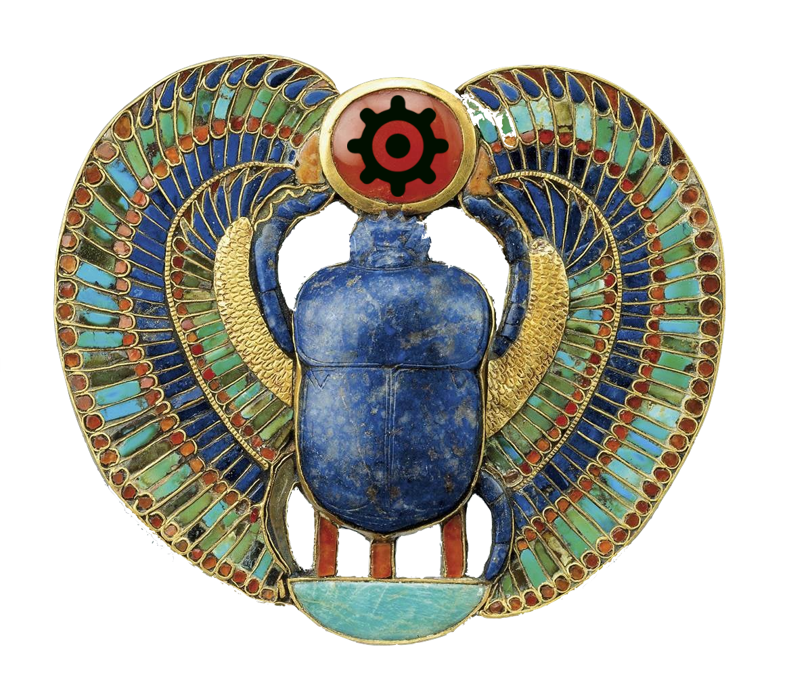

# Datamaps for Small Business

Map the oceans of data in your small business's LLM Wiki. Datamaps for Small
Business is a Claude Code skill, `/datamap`, that turns your reviews, survey
answers, notes or website into an interactive map of what's in them, plus a
plain-language report on what to do next.

**[See the live demo →](https://connoiter.github.io/claude_for_small_businesses_hackathon/)** Three real datamaps (a consultant's 585 notes, thinkspace's 629-page website and Sourcegraph's handbook), each with an example conversation showing how an owner works with the map. No install needed.

## Introduction

Give Claude all your data in a private LLM Wiki, formatted in the new standard
for second brains, Google's Open Knowledge Format (OKF). A few minutes later
you get **a visual map of your small business's data that your agent has in
its wiki.** Similar comments sit together, each group is named in plain words,
and you can hover over any dot to read the comment. It's one file you can
email to your partner or staff, and it opens in any browser, even in airplane
mode.

You don't need to write any code, and your data stays on your computer.
Claude only reads a few examples from each group so it can name the groups.

### Example: a café's reviews

> **See it first:** download [`examples/lakeview-cafe/map.html`](examples/lakeview-cafe/map.html)
> and open it in your browser, then read the
> [report](examples/lakeview-cafe/insights.md). It maps 260 reviews of
> Lakeview Coffee & Bakery, a made-up Seattle café (the reviews are synthetic).

From the example report:

> **Fix these first**
> 1. **Mobile orders not ready**: 22 people, average 1.9★. Send the 'ready'
>    notification when the drink is handed off, not when the ticket prints.
> 2. **Long weekday morning lines**: 21 people, average 2.4★. Add a third
>    person on weekdays from 7:30 to 9:30.
> 3. **Loyalty app losing points**: 15 people, average 2.3★. Restore lost points
>    for anyone with a screenshot.

### Example: your own notes

It works on your own notes too. Point it at a folder of documents, such
as an Obsidian vault, a "second brain", or an
[OKF](https://www.gitbook.com/blog/what-is-okf-open-knowledge-format) bundle,
and it shows what you know and which topics you could sell as a service. See
[`examples/knowledgeforge`](examples/knowledgeforge): 398 notes from a solo
consultant's knowledge base, grouped into 16 areas like "Running teams of AI
agents" and "Google Ads and keyword research".

## Getting started

### What you need

- [Claude Code](https://claude.com/claude-code), with any paid Claude plan.
- [uv](https://docs.astral.sh/uv/getting-started/installation/), a free
  one-line install. Claude can install it for you.
- A CSV or Excel export of your customer text, or a folder of documents
  (`.md`, `.txt`, `.pdf`). Most review sites, survey tools and help desks
  have an "Export to CSV" button. For OKF bundles, the reserved `index.md`
  and `log.md` are skipped.

### Set up (once)

1. Download this project: on GitHub, click **Code → Download ZIP** and unzip it.
   (Or `git clone` it.)
2. Open the folder in Claude Code.

### Use it

Type:

```
/datamap
```

Claude asks which file or folder to map, runs everything, names the groups,
and opens the map. You can also just say *"what are my customers saying in
reviews.csv?"* or *"what's in my notes folder?"* or *"map my website, https://yourbusiness.com"*

If you give it a folder of notes, Claude first checks and tidies a copy of
them (your folder is never changed). It tells you what it found, such as
notes missing a label, headers too broken for AI tools to read, or the same
note saved twice. See [DATA_CURATION.md](DATA_CURATION.md) for what this found
in a real knowledge base.

The first run downloads a small language model (about 90 MB) and takes a few
minutes. Later runs take about a minute.

### What you get

Everything is saved in `out/<name>/`:

| File | What it is |
|---|---|
| `map.html` | The interactive map. Hover over dots to read comments, search at the top, filter by month at the bottom. |
| `insights.md` | The report: fix these first, every group with quotes and a suggested action, spam and double posts. |
| `labels.json` | The group names Claude wrote. Edit any of them and run `datamap render` again. |

### Privacy

Reading your files, building the map and grouping comments all happen on your
computer, using a small open-source model. To name the groups, Claude reads
only the briefing file: about 8 typical comments per group plus the 15 most
unusual ones. Nothing else is uploaded.

## Built on the King Tutte Datamap Scrolls

<div align="center">
  <a href="https://en.wikipedia.org/wiki/Mask_of_Tutankhamun">
    
  </a>
  <p>Funerary mask of Bill Tutte</p>
</div>

We coded this with Claude Code, using the
[King Tutte Datamap Scrolls](https://github.com/Connoiter/king_tutte_datamap_scrolls)
as our datamap SDK. The Scrolls are a how-to manual for building
"King Tutte pipelines": code, docs, papers and recorded talks for the
open-source datamapping tools from the
[Tutte Institute for Mathematics and Computing](https://github.com/TutteInstitute),
gathered in one place so a developer, human or agent, can build datamaps
from them. Claude read the Scrolls and built this repo's pipeline from them:

- **The pipeline shape.** Embed the text, lay it out with UMAP, group it with
  HDBSCAN, and draw it with DataMapPlot, as the Scrolls describe.
- **The `documents` table.** For notes folders, `/datamap` writes the `documents` table
  (`id`, `text`, `title`, `url`) that the Scrolls specify for Seshette, their
  generic `/datamap` toolkit, so this repo can switch over to Seshette's
  scribes when they ship.
- **The small-business part is ours.** Reading review exports, tidying notes
  into OKF, having Claude name the groups, and the plain-language report.

### Why "King Tutte"?

Bill Tutte was the British-Canadian codebreaker and
mathematician the Tutte Institute is named after. The name is a nod to King
Tut, who has been immortalized in song, as
[can be seen on YouTube](https://www.youtube.com/embed/k-fc3UrLRLQ?autoplay=1&mute=1&loop=0).

<div align="center">
  <a href="https://www.youtube.com/embed/k-fc3UrLRLQ?autoplay=1&mute=1&loop=0">
    
  </a>
</div>

## For developers

The skill is [`.claude/skills/datamap/SKILL.md`](.claude/skills/datamap/SKILL.md).
It drives a short command line:

```
# Notes folders only (a website becomes one when Claude saves its pages as notes):
# tidy a copy into an OKF bundle, then write Seshette's documents table
uv run datamap okf <notes folder> --out out/<name>

uv run datamap prepare <csv|xlsx|folder|documents.parquet> --out out/<name>   # read → embed → lay out → group
# Claude reads out/<name>/briefing.md and writes out/<name>/labels.json
uv run datamap render --out out/<name>                                        # map.html + insights.md
```

| Stage | Tool |
|---|---|
| Tidy notes into OKF | [`datamap/convert_to_okf.py`](datamap/convert_to_okf.py), [`datamap/okf_to_documents.py`](datamap/okf_to_documents.py) |
| Embed | [sentence-transformers](https://www.sbert.net/) `all-MiniLM-L6-v2`, on the CPU |
| Lay out | [UMAP](https://github.com/lmcinnes/umap) |
| Group | [fast_hdbscan](https://github.com/TutteInstitute/fast_hdbscan) |
| Name groups, flag spam | Claude, from `briefing.md` |
| Render | [DataMapPlot](https://github.com/TutteInstitute/datamapplot), single file |

Options: `prepare` takes `--text-col`, `--title-col` and `--min-cluster-size`. `render` takes
`--link-base <site URL>`. Clicking a dot normally opens the original file (for folders and
OKF bundles); with `--link-base` it opens that document's page on a site built from the same
folder instead, for example a Hugo site of the OKF bundle.

## Hackathon

### Credits

This is a "King Tutte pipeline": the open-source datamapping tools from the
[Tutte Institute for Mathematics and Computing](https://github.com/TutteInstitute)
(UMAP, HDBSCAN, DataMapPlot), packaged for small businesses. The pipeline
design comes from the
[King Tutte Datamap Scrolls](https://github.com/Connoiter/king_tutte_datamap_scrolls)
and [Connoiter](https://connoiter.com/blog/).

Built at the Claude for Small Business hackathon, Seattle, October 25, 2026.

### How this meets the judging criteria

The demo video follows the same five criteria; its script and shot list are in
[DEMO_VIDEO.md](DEMO_VIDEO.md).

#### Does it work

Yes, end to end. `/datamap` reads a CSV, Excel file or
folder, groups the text, has Claude name the groups, and writes the map and
report. Both examples in [`examples/`](examples) are real output from it: 260
café reviews in [`lakeview-cafe`](examples/lakeview-cafe) and 398 real notes in
[`knowledgeforge`](examples/knowledgeforge). An owner could try it today on
their own review export.

#### Ease of setup for a small business

No code. Download the ZIP, open the
folder in Claude Code, type `/datamap`. Claude asks which file to use and
installs `uv` if needed. The result is a single `map.html` that opens in any
browser and can be emailed to staff. Our team set it up cold from this README
to check that.

#### Impact on the business's operations

Owners collect reviews, surveys and
support emails but rarely read them all. The report turns them into a short
"fix these first" list with how many people raised each issue, their average
rating and a concrete next step, for example: 22 people, 1.9★, "send the ready
notification at hand-off, not when the ticket prints." It also flags spam and
double posts so they don't skew the picture. For notes, it shows which areas of
an owner's know-how could become a paid service, guide or workshop.

#### Creativity

Datamaps are a research tool, built on the Tutte Institute's
UMAP, HDBSCAN and DataMapPlot. We packaged them so an owner can use them, and
paired them with Claude to name the groups and write the actions. The heavy
work runs locally on a small open-source model, so Claude only reads about 8
examples per group and the customers' text stays on the owner's computer. The
same pipeline also maps an owner's own notes. First it tidies a copy into
Open Knowledge Format and reports what it fixed (see
[DATA_CURATION.md](DATA_CURATION.md)), such as three notes whose broken headers
were silently hiding all their tags.

#### Teamwork

Every member had a distinct role, listed in the table below:
owner research and pitch, the Claude skill and report, the map and demo video,
the pipeline, and a cold-start test of the README. Work landed as separate pull
requests ([#1](https://github.com/Connoiter/claude_for_small_businesses_hackathon/pull/1),
[#2](https://github.com/Connoiter/claude_for_small_businesses_hackathon/pull/2),
[#3](https://github.com/Connoiter/claude_for_small_businesses_hackathon/pull/3)).

### Team

<!-- TODO(team): replace each role with what you actually did before submitting. -->

| Who | Role |
|---|---|
| John Tigue | Lead; King Tutte pipeline; project conceptor; live demo |
| Cato Lin | `/datamap` skill, ingest, Claude labeling, insights report |
| Poonam Sharma | Map experience, sample data, demo video |
| Jolie Martin | Owner research, use case, README, pitch |

## License

[Apache-2.0](LICENSE)

<div align="center">
  
</div>
